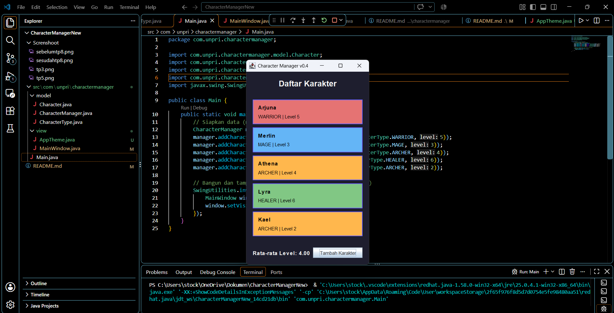
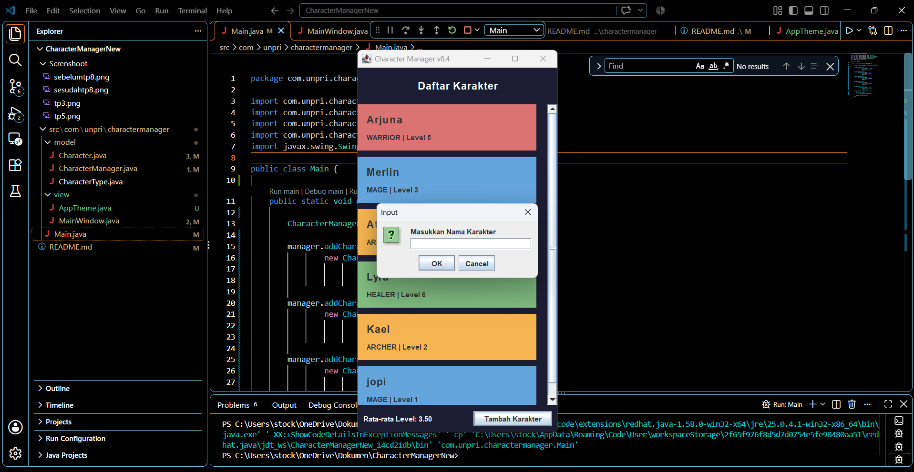
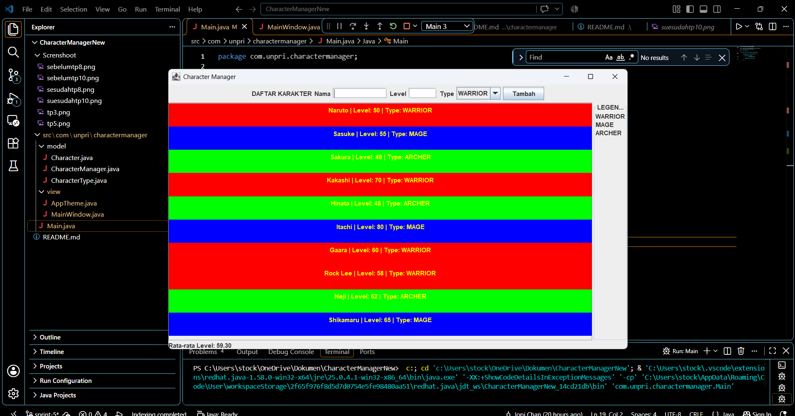
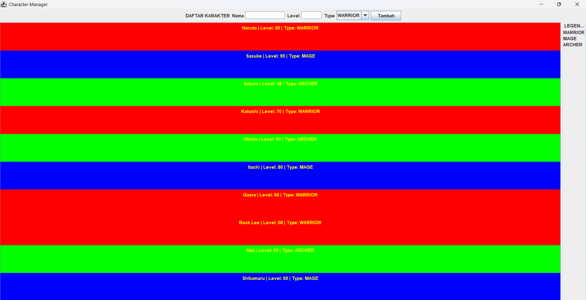
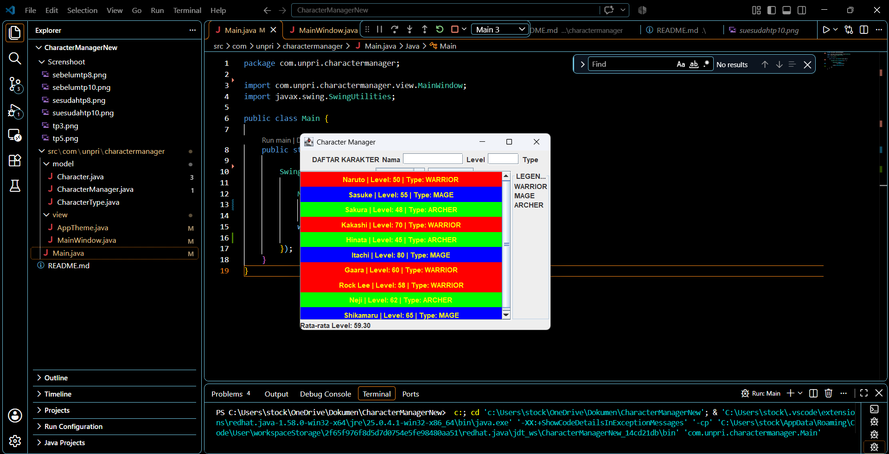
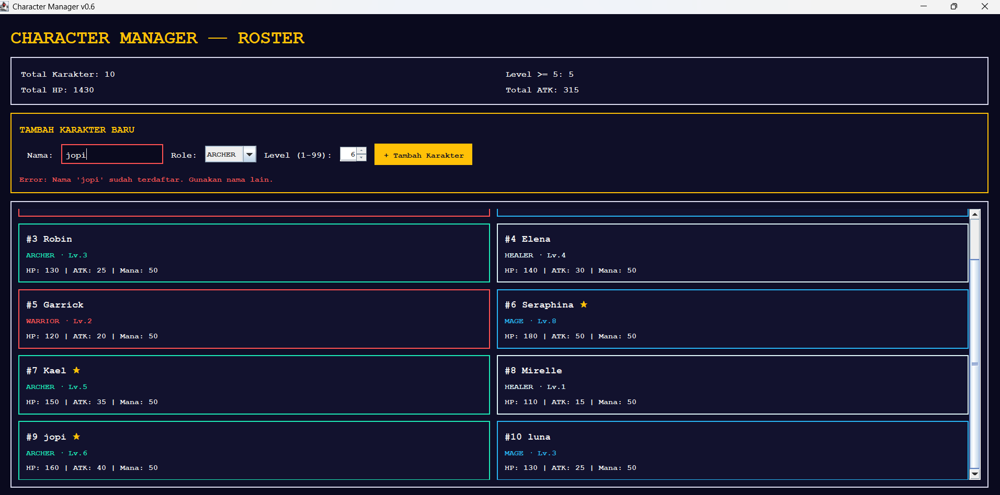
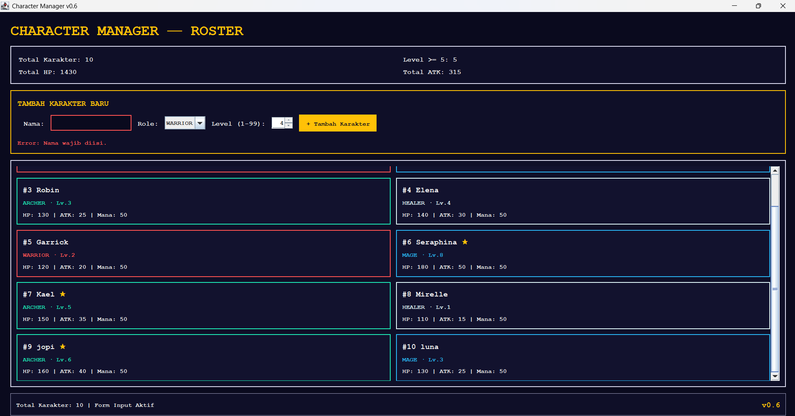

# Character Manager — TP3 (Java Visual SIH-6406)

# Deskripsi 

Character Manager adalah fondasi model class untuk aplikasi pengelolaan karakter game yang ditulis dengan Java. Project ini berisi enum CharacterType, class Character dengan dua constructor dan validasi melalui encapsulation, serta Main untuk mendemokan pembuatan karakter, level up, fitur mana, dan isAlive(). Model ini disiapkan sebagai dasar sebelum GUI dibangun di sprint berikutnya.

# Hasil Output 


 # Struktur Folder

```
javavisual-tp03-253303621235/
├── README.md
├── screenshots/
│   └── output.png
└── CharacterManager/
    └── src/
        └── com/
            └── unpri/
                └── charactermanager/
                    ├── Main.java
                    └── model/
                        ├── Character.java
                        └── CharacterType.java

# Identitas

Nama : [JOPI CHAN]
Nim : [253303621235]
Google Docs Bagian D : [https://1drv.ms/w/c/265fce39944988d2/IQBSaEjTa1-HRouFOAIbQDK6Ab6l14r5AjI12270OtqmmGg?e=IqIOHU]

_________________________________________________________________________________________________________________________________

# Character Manager — TP5 (Java Visual SIH-6406)

# Deskripsi

Character Manager adalah aplikasi Java berbasis console untuk mengelola
karakter game. Proyek ini adalah fondasi model class yang nantinya
dipakai tim untuk membangun GUI di sprint berikutnya. Versi ini
mencakup model `Character` dan `CharacterType` (enum), serta
`CharacterManager` yang menyimpan, mencari, menghapus, dan
menganalisis koleksi karakter dengan menjaga encapsulation.

# Fitur

- Model `Character` dengan dua constructor (karakter baru dan
  karakter dari database), getter/setter, `isAlive()`, dan `toString()`
- `CharacterType` berupa enum: `WARRIOR`, `MAGE`, `ARCHER`, `HEALER`
- `CharacterManager`: `addCharacter()`, `findByName()`,
  `removeCharacter()`, `getTotalCharacters()`, `getAllCharacters()`,
  dan `findStrongest()`
- Penolakan karakter dengan nama duplikat
- `getAllCharacters()` mengembalikan salinan, bukan list asli

# Hasil Output
Screnshoot/tp5.png

# Struktur Folder

```
CharacterManagerNew/
├── Screenshoot/
│   └── tp3.png
├── src/
│   └── com/unpri/charactermanager/
│       ├── Main.java
│       ├── CharacterManager.java
│       └── model/
│           ├── Character.java
│           └── CharacterType.java
└── README.md
                       
 # Identitas

Nama : [JOPI CHAN]
Nim : [253303621235]
Google Docs Bagian D :  https://1drv.ms/w/c/a197bb3390d52b1d/IQCfSQy2OWmtTZzS3EMCW56VAUFQgrdwih30_6rbRptsnb8?e=eR6OuY                    

_________________________________________________________________________________________________________________________________

# TP8 — Transisi dari Console ke GUI (Swing)

# Deskripsi
Main` membuat objek `CharacterManager`, mengisinya dengan lima objek
`Character`, lalu menyerahkan manager itu ke `MainWindow` lewat
constructor di dalam `SwingUtilities.invokeLater()`. `MainWindow` tidak
menyimpan datanya sendiri: ia memanggil `getAllCharacters()` dan
`getAverageLevel()` pada manager, lalu menggambar hasilnya menjadi baris
`JLabel` lewat loop. Dalam pola MVC, `Character`, `CharacterType`, dan
`CharacterManager` adalah **Model** (data dan aturannya), `MainWindow`
adalah **View** (tampilan), sedangkan peran **Controller** pada aplikasi
sederhana ini dipegang oleh `Main` (menyiapkan dan menghubungkan data)
dan event handler tombol di `MainWindow` (meneruskan input pengguna ke
model). Karena perhitungan rata-rata ada di `CharacterManager`, bukan di
`MainWindow`, tampilan bisa diganti tanpa mengubah logika datanya.

 Karakter Baru dan Alasan Pemilihan

| Nama | Tipe | Level | Alasan |
|---|---|---|---|
| Lyra | HEALER | 6 | Tiga karakter awal hanya mewakili WARRIOR, MAGE, dan ARCHER, jadi HEALER ditambahkan agar keempat nilai `CharacterType` muncul di daftar. Level 6 sengaja dibuat paling tinggi agar rentang level lebih lebar. |
| Kael | ARCHER | 2 | Tipe ARCHER dipakai lagi untuk menunjukkan bahwa dua karakter bisa bertipe sama tetapi berlevel beda. Level 2 sengaja paling rendah agar rata-rata level jelas terpengaruh oleh data. |

Total level kelima karakter adalah 20, sehingga rata-rata level yang
tampil adalah 4.00. [Sesuaikan alasan di tabel ini dengan alasanmu
sendiri.]

 Fitur Tambahan

- Tombol **Tambah Karakter** dengan input nama, tipe, dan level.
- Nama kosong dan nama duplikat ditolak dengan pesan peringatan.
- Setelah karakter ditambah, daftar, jumlah karakter, dan rata-rata
  level diperbarui otomatis lewat `refreshView()`.

  # Hasil Output Sebelum
 

  # Hasil Output Sesudah
  

# Struktur Project
CharacterManagerNew/
├── Screenshoot/
│   ├── tp3.png
│   ├── tp5.png
│   ├── tp8-sebelum.png
│   └── tp8-sesudah.png
├── src/
│   └── com/unpri/charactermanager/
│       ├── Main.java
│       ├── model/
│       │   ├── Character.java
│       │   ├── CharacterManager.java
│       │   └── CharacterType.java
│       └── view/
│           └── MainWindow.java
└── README.md

# Identitas
Nama : JOPI CHAN
Nim: 253303621235
Google Doc : https://1drv.ms/w/c/a197bb3390d52b1d/IQCmVvgWy62TRZ3MUnxMO8YPAU_S4tZIRRheUmQU-QijTKQ?e=egPCxs

_________________________________________________________________________________________________________________________________

# TP10 - GUI Character Manager

# Deskripsi

Mengapa Warna Disimpan di AppTheme dan Bukan di Character?
Warna disimpan pada kelas AppTheme karena warna merupakan bagian dari tampilan (View), bukan bagian dari data karakter (Model). Kelas Character bertugas menyimpan informasi penting seperti nama, tipe, dan level karakter, sehingga tidak perlu mengetahui bagaimana karakter tersebut ditampilkan pada layar.

Dengan memisahkan warna ke dalam AppTheme, perubahan tampilan dapat dilakukan tanpa mengubah struktur data karakter. Pendekatan ini juga membuat kode lebih rapi, mudah dirawat, dan sesuai dengan prinsip MVC yang memisahkan data dan presentasi.

Properti Tambahan yang Dipilih
1. Color Theme
Aplikasi menggunakan AppTheme untuk menyimpan warna yang berbeda pada setiap tipe karakter seperti Warrior, Mage, Archer, dan Healer.

Alasan:

Tampilan menjadi lebih menarik.
Pengguna dapat membedakan tipe karakter dengan cepat melalui warna.
2. Average Level Statistic
Aplikasi menampilkan rata-rata level seluruh karakter pada bagian bawah jendela.

Alasan:

Memberikan informasi statistik secara langsung kepada pengguna.
Mempermudah analisis perkembangan karakter yang tersimpan dalam sistem.

# Hail Output Sebelum


# Hail Output Sesudah


# Struktur Project
CharacterManagerNew/
│
├── README.md
│
├── Screenshot/
│   ├── tp3.png
│   ├── tp5.png
│   ├── tp8.png
│   ├── sebelumtp8.png
│   └── sesudahtp8.png
│
└── src/
    └── com/
        └── unpri/
            └── charactermanager/
                ├── model/
                │   ├── Character.java
                │   ├── CharacterManager.java
                │   └── CharacterType.java
                │
                ├── view/
                │   ├── AppTheme.java
                │   └── MainWindow.java
                │
                └── Main.java


 # Identitas
Nama : JOPI CHAN
Nim: 253303621235
Google Doc : https://1drv.ms/w/c/a197bb3390d52b1d/IQBaKjcsZ7QuRoemaHkUP6kQAXtzX8ExsPrNBGAZkUUjkBk?e=zqGnHt            

________________________________________________________________________

# Character Manager — TP3 (Java Visual SIH-6406)

# Deskripsi

Struktur Panel Bersarang
uktur panel bersarang (nested panel) untuk memisahkan bagian antarmuka menjadi beberapa area yang memiliki tanggung jawab berbeda. Panel utama menggunakan BorderLayout sebagai root container, kemudian setiap area seperti header, daftar karakter, legenda, dan status bar ditempatkan pada region yang sesuai.

Bagian header menggunakan JPanel yang berisi komponen input karakter seperti nama, level, tipe, dan tombol tambah. Bagian tengah menggunakan JScrollPane yang membungkus panel daftar karakter sehingga daftar dapat di-scroll ketika jumlah data bertambah banyak. Di sisi kanan terdapat panel legenda untuk menampilkan kategori tipe karakter, sedangkan bagian bawah berisi panel status yang menampilkan informasi rata-rata level karakter.

Struktur panel bersarang membuat antarmuka lebih terorganisir, mudah dikembangkan, dan mendukung proses resize jendela tanpa merusak tata letak komponen.

Alasan Panel Tambahan dan Layout yang Dipilih
Layout yang Digunakan
BorderLayout sebagai layout utama JFrame.
BoxLayout untuk daftar karakter.
FlowLayout pada panel input bagian atas.
Alasan Pemilihan
BorderLayout dipilih karena mempermudah pembagian area aplikasi menjadi header, konten utama, legenda, dan status bar. BoxLayout digunakan untuk menyusun daftar karakter secara vertikal sehingga data dapat bertambah secara dinamis. FlowLayout digunakan pada panel input karena komponen dapat tersusun rapi dari kiri ke kanan.

Layout yang Ditolak
Null Layout
GridLayout sebagai layout utama
Null Layout tidak dipilih karena setiap komponen harus diatur menggunakan koordinat manual (setBounds) sehingga sulit menyesuaikan ukuran jendela ketika aplikasi di-resize. GridLayout juga tidak digunakan sebagai layout utama karena seluruh area akan memiliki ukuran yang sama sehingga kurang cocok untuk aplikasi yang memiliki header, konten utama, dan status bar dengan ukuran berbeda.

Tabel Pengamatan Resize
Kondisi	Prediksi	Hasil
Jendela Diperbesar	Daftar karakter melebar dan area scroll bertambah	Sesuai
Jendela Diperkecil	Scrollbar tetap muncul dan data masih dapat diakses	Sesuai
Tinggi Jendela Berkurang	Komponen menyesuaikan area yang tersedia	Sesuai

# Hasil Output Ukuran Normal


# Hasil Output Ukuran Besar


# Hasil Output Ukuran Kecil


# Struktur Project
CharacterManagerNew/
│
├── README.md
│
├── screenshots/
│   ├── tp3.png
│   ├── tp5.png
│   ├── tp8.png
│   ├── sebelumtp8.png
│   ├── sesudahtp8.png
│   ├── sesudahtp10.png
│   ├── wireframe_tp12.png
│   ├── tp12_awal.png
│   ├── tp12_besar.png
│   └── tp12_kecil.png
│
└── src/
    └── com/
        └── unpri/
            └── charactermanager/
                │
                ├── model/
                │   ├── Character.java
                │   ├── CharacterManager.java
                │   └── CharacterType.java
                │
                ├── view/
                │   ├── AppTheme.java
                │   └── MainWindow.java
                │
                └── Main.java

# Identitas
Nama : Jopi Chan
Nim : 253303621235
Google Doc : https://1drv.ms/w/c/a197bb3390d52b1d/IQBaKjcsZ7QuRoemaHkUP6kQAXtzX8ExsPrNBGAZkUUjkBk?e=Uqvzu5

_________________________________________________________________________________________________________________________________

# Character Manager v0.6 TP 14

# Deskripsi

Character Manager adalah aplikasi berbasis Java Swing yang digunakan untuk mengelola daftar karakter game. Pengguna dapat menambahkan karakter baru melalui form input, melihat statistik roster, serta menampilkan kartu karakter berdasarkan role dan level.
 
Fitur utama:

Menambah karakter baru
Validasi input nama
Validasi role dan level
Statistik roster
Tampilan kartu karakter
Tema gelap (Dark Theme)
Legenda role karakter

Aturan Validasi
Validation pada View
Nama wajib diisi
Input nama tidak boleh kosong.

Nama tidak boleh diawali spasi
Contoh:

 Arthur
akan ditolak.

Nama hanya boleh huruf dan spasi
Contoh:

Arthur123
akan ditolak.

Nama tidak boleh duplikat
Nama yang sudah digunakan sebelumnya tidak dapat ditambahkan kembali.

Validation pada Model
MAGE tidak boleh level di atas 60
Jika role karakter adalah MAGE, maka level maksimum yang diperbolehkan adalah 60.

Contoh:

Role : MAGE
Level: 61
akan ditolak.

Alasan:

Aturan ini merupakan aturan bisnis karakter sehingga harus tetap berlaku walaupun objek dibuat dari luar GUI.

Tabel Uji
No	Input	Hasil Diharapkan	Hasil Nyata	Lapisan
1	Nama kosong	Error nama wajib diisi	Sesuai	View
2	Nama diawali spasi	Error nama tidak boleh diawali spasi	Sesuai	View
3	Nama mengandung angka	Error hanya boleh huruf	Sesuai	View
4	Nama duplikat	Error nama sudah digunakan	Sesuai	View
5	Warrior Level 80	Berhasil dibuat	Sesuai	Model
6	Mage Level 61	Error Mage tidak boleh level > 60	Sesuai	Model
7	Nama lebih dari batas karakter	Error validasi nama	Sesuai	View
8	Karakter ke-21	Error maksimal 20 karakter	Sesuai	Model

Catatan Hasil Pengujian
Seluruh pengujian menghasilkan output sesuai dengan hasil yang diharapkan.

Tidak ditemukan bug yang menyebabkan aplikasi gagal melakukan validasi ataupun menampilkan karakter ke roster.

Penjelasan Kompromi Sementara
Pada implementasi ini masih digunakan ActionListener sederhana yang langsung memanggil operasi pada CharacterManager. Pendekatan tersebut dipilih untuk menjaga struktur kode tetap sederhana dan mudah dipahami pada skala tugas praktikum. Selain itu, komunikasi antara View dan Model masih dilakukan secara langsung tanpa lapisan Controller terpisah. Pada pengembangan berikutnya, pola MVC dapat diterapkan secara lebih lengkap untuk meningkatkan pemeliharaan dan skalabilitas aplikasi.

Cara Menjalankan Program
Compile project Java.
Jalankan class Main.
Form Character Manager akan muncul.
Masukkan nama, role, dan level karakter.
Klik tombol Tambah Character.
Karakter akan muncul pada panel roster.

# Hasil Output Berhasil


# Hasil Output Error Nama Duplikat


# Hasil Output Nama Kosong


# Struktur Project

CharacterManagerNew
│
├── src
│   └── com
│       └── unpri
│           └── charactermanager
│
│               ├── Main.java
│               │
│               ├── model
│               │   ├── Character.java
│               │   ├── CharacterManager.java
│               │   └── CharacterType.java
│               │
│               └── view
│                   ├── AppTheme.java
│                   ├── CharacterFormPanel.java
│                   └── MainWindow.java
│
├── README.md
│
└── Screenshot
    ├── error-nama-kosong.png
    ├── error-nama-duplikat.png
    └── sukses-tambah-karakter.png

# Identitas
Nama : Jopi Chan
Nim : 253303621235
Google Doc : https://1drv.ms/w/c/a197bb3390d52b1d/IQDNmdEp00B-QoewmZxZPYBcAT312TjeohTfcqXVCeTh3dw?e=nf1Kiw


