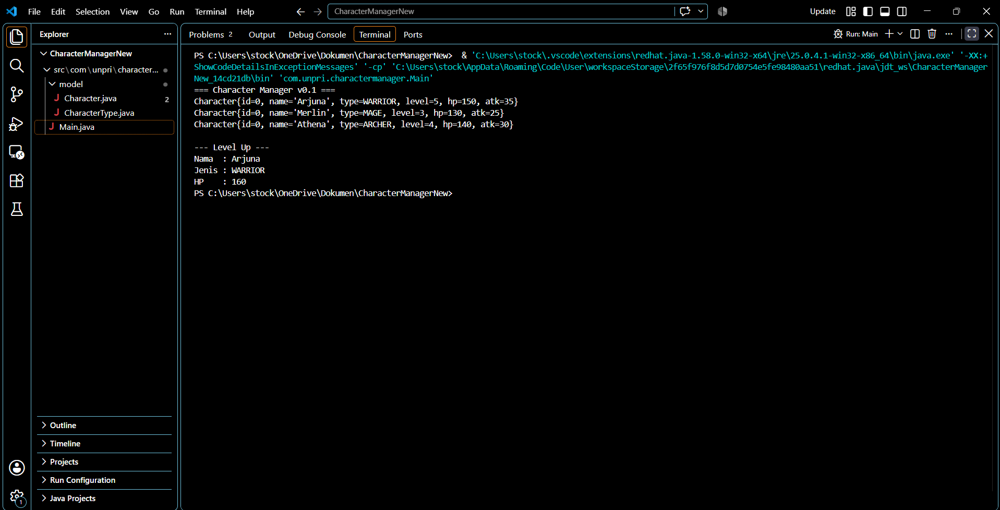
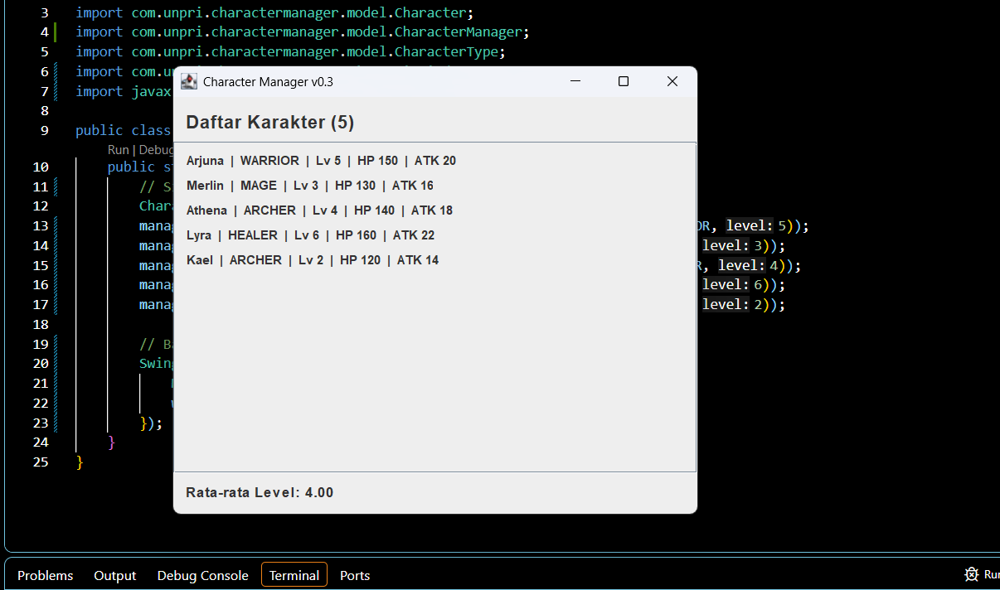
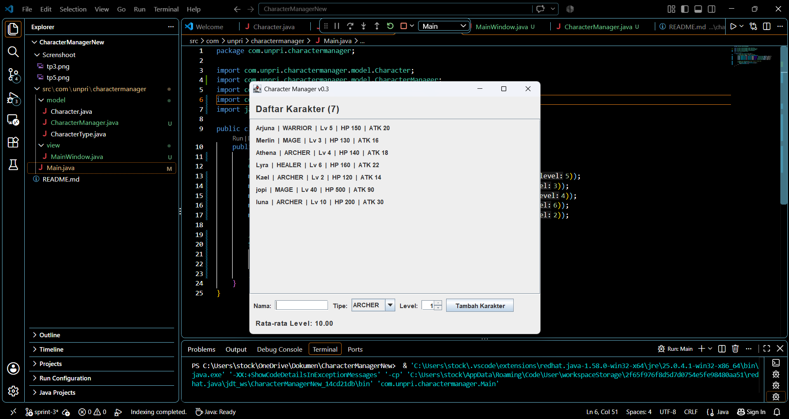

# Character Manager — TP3 (Java Visual SIH-6406)

# Deskripsi 

Character Manager adalah fondasi model class untuk aplikasi pengelolaan karakter game yang ditulis dengan Java. Project ini berisi enum CharacterType, class Character dengan dua constructor dan validasi melalui encapsulation, serta Main untuk mendemokan pembuatan karakter, level up, fitur mana, dan isAlive(). Model ini disiapkan sebagai dasar sebelum GUI dibangun di sprint berikutnya.

# Hasil Output 


 # Struktur Folder

```
javavisual-tp03-253303621235/
├── README.md
├── screenshots/
│   └── output.png
└── CharacterManager/
    └── src/
        └── com/
            └── unpri/
                └── charactermanager/
                    ├── Main.java
                    └── model/
                        ├── Character.java
                        └── CharacterType.java

# Identitas

Nama : [JOPI CHAN]
Nim : [253303621235]
Google Docs Bagian D : [https://1drv.ms/w/c/265fce39944988d2/IQBSaEjTa1-HRouFOAIbQDK6Ab6l14r5AjI12270OtqmmGg?e=IqIOHU]

_________________________________________________________________________________________________________________________________

# Character Manager — TP5 (Java Visual SIH-6406)

# Deskripsi

Character Manager adalah aplikasi Java berbasis console untuk mengelola
karakter game. Proyek ini adalah fondasi model class yang nantinya
dipakai tim untuk membangun GUI di sprint berikutnya. Versi ini
mencakup model `Character` dan `CharacterType` (enum), serta
`CharacterManager` yang menyimpan, mencari, menghapus, dan
menganalisis koleksi karakter dengan menjaga encapsulation.

# Fitur

- Model `Character` dengan dua constructor (karakter baru dan
  karakter dari database), getter/setter, `isAlive()`, dan `toString()`
- `CharacterType` berupa enum: `WARRIOR`, `MAGE`, `ARCHER`, `HEALER`
- `CharacterManager`: `addCharacter()`, `findByName()`,
  `removeCharacter()`, `getTotalCharacters()`, `getAllCharacters()`,
  dan `findStrongest()`
- Penolakan karakter dengan nama duplikat
- `getAllCharacters()` mengembalikan salinan, bukan list asli

# Hasil Output
Screnshoot/tp5.png

# Struktur Folder

```
CharacterManagerNew/
├── Screenshoot/
│   └── tp3.png
├── src/
│   └── com/unpri/charactermanager/
│       ├── Main.java
│       ├── CharacterManager.java
│       └── model/
│           ├── Character.java
│           └── CharacterType.java
└── README.md
                       
 # Identitas

Nama : [JOPI CHAN]
Nim : [253303621235]
Google Docs Bagian D :  https://1drv.ms/w/c/a197bb3390d52b1d/IQCfSQy2OWmtTZzS3EMCW56VAUFQgrdwih30_6rbRptsnb8?e=eR6OuY                    

_________________________________________________________________________________________________________________________________

# TP8 — Transisi dari Console ke GUI (Swing)

# Deskripsi
Main` membuat objek `CharacterManager`, mengisinya dengan lima objek
`Character`, lalu menyerahkan manager itu ke `MainWindow` lewat
constructor di dalam `SwingUtilities.invokeLater()`. `MainWindow` tidak
menyimpan datanya sendiri: ia memanggil `getAllCharacters()` dan
`getAverageLevel()` pada manager, lalu menggambar hasilnya menjadi baris
`JLabel` lewat loop. Dalam pola MVC, `Character`, `CharacterType`, dan
`CharacterManager` adalah **Model** (data dan aturannya), `MainWindow`
adalah **View** (tampilan), sedangkan peran **Controller** pada aplikasi
sederhana ini dipegang oleh `Main` (menyiapkan dan menghubungkan data)
dan event handler tombol di `MainWindow` (meneruskan input pengguna ke
model). Karena perhitungan rata-rata ada di `CharacterManager`, bukan di
`MainWindow`, tampilan bisa diganti tanpa mengubah logika datanya.

 Karakter Baru dan Alasan Pemilihan

| Nama | Tipe | Level | Alasan |
|---|---|---|---|
| Lyra | HEALER | 6 | Tiga karakter awal hanya mewakili WARRIOR, MAGE, dan ARCHER, jadi HEALER ditambahkan agar keempat nilai `CharacterType` muncul di daftar. Level 6 sengaja dibuat paling tinggi agar rentang level lebih lebar. |
| Kael | ARCHER | 2 | Tipe ARCHER dipakai lagi untuk menunjukkan bahwa dua karakter bisa bertipe sama tetapi berlevel beda. Level 2 sengaja paling rendah agar rata-rata level jelas terpengaruh oleh data. |

Total level kelima karakter adalah 20, sehingga rata-rata level yang
tampil adalah 4.00. [Sesuaikan alasan di tabel ini dengan alasanmu
sendiri.]

 Fitur Tambahan

- Tombol **Tambah Karakter** dengan input nama, tipe, dan level.
- Nama kosong dan nama duplikat ditolak dengan pesan peringatan.
- Setelah karakter ditambah, daftar, jumlah karakter, dan rata-rata
  level diperbarui otomatis lewat `refreshView()`.

  # Hasil Output Sebelum


  # Hasil Output Sesudah
  

# Struktur Project
CharacterManagerNew/
├── Screenshoot/
│   ├── tp3.png
│   ├── tp5.png
│   ├── tp8-sebelum.png
│   └── tp8-sesudah.png
├── src/
│   └── com/unpri/charactermanager/
│       ├── Main.java
│       ├── model/
│       │   ├── Character.java
│       │   ├── CharacterManager.java
│       │   └── CharacterType.java
│       └── view/
│           └── MainWindow.java
└── README.md

# Identitas
Nama : [JOPI CHAN]
Nim : [253303621235]
Google Docs Bagian D : https://1drv.ms/w/c/a197bb3390d52b1d/IQCmVvgWy62TRZ3MUnxMO8YPAU_S4tZIRRheUmQU-QijTKQ?e=1W13qb